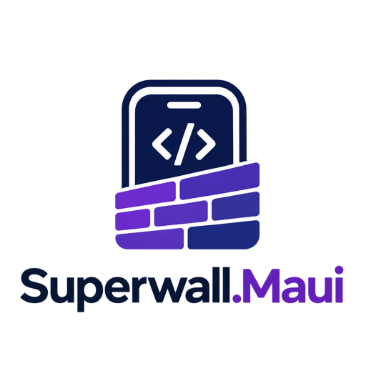

<p align="center">
  
</p>

# Superwall.Maui

[](https://www.nuget.org/packages/Superwall.Maui)
[](https://github.com/nrcpp/Superwall.Maui/blob/main/LICENSE)

Unofficial .NET MAUI bridge to the official [Superwall](https://superwall.com) SDKs for iOS and Android. It is not affiliated with Superwall. Source, issues and changelog: [github.com/nrcpp/Superwall.Maui](https://github.com/nrcpp/Superwall.Maui).

The package wraps the native SDKs and does not reimplement them. Paywalls, purchases, restore, audiences and analytics all run inside the native SDKs:

| Platform | Native SDK | Minimum OS |
|---|---|---|
| iOS | SuperwallKit 4.19.0 | iOS 15.0 |
| Android | superwall-android 2.9.0 | Android 6.0 (API 23) |

Requirements: .NET 10 SDK with the `maui-ios` / `maui-android` workloads (MAUI 10.0.110 or later). For iOS, use the Xcode version your .NET iOS workload requires.

## Install

```bash
dotnet add package Superwall.Maui --prerelease
```

Native code ships prebuilt in the package. Building your app doesn't need Xcode projects, Gradle or CocoaPods.

## Configure

Create an iOS app and an Android app in the Superwall dashboard and copy their public API keys (`pk_...`).

```csharp
// MauiProgram.cs
using Superwall.Maui;

builder.UseSuperwall(o =>
{
    o.AppleApiKey = "pk_ios_...";
    o.AndroidApiKey = "pk_android_...";
    o.LogLevel = SuperwallLogLevel.Warn;
});
```

The SDK is configured at app launch: `FinishedLaunching` on iOS and `Application.OnCreate` on Android. `UseSuperwall` throws if the key for the current platform is missing. Resolve `ISuperwall` from DI.

Optional settings (`null` keeps the native SDK default):

```csharp
o.TestModeBehavior = SuperwallTestModeBehavior.Automatic;   // Always / Never / WhenEnabledForUser
o.LocaleIdentifier = "en_GB";
o.EventTrackingBehavior = SuperwallEventTrackingBehavior.All; // SuperwallOnly / None
o.Paywalls.ShouldPreload = false;            // then call PreloadAllPaywalls() / PreloadPaywalls(...)
o.Paywalls.AutomaticallyDismiss = true;
o.Paywalls.ShouldShowPurchaseFailureAlert = true;
o.Paywalls.IsHapticFeedbackEnabled = true;
```

## Show a paywall

```csharp
await superwall.RegisterPlacementAsync(
    "campaign_trigger",
    parameters: new Dictionary<string, object> { ["source"] = "settings" },
    handler: new PaywallPresentationHandler
    {
        OnPresent = info => Console.WriteLine($"Presented {info.Identifier}"),
        OnDismiss = (info, result) => Console.WriteLine($"Dismissed: {result}"), // Purchased / Declined / Restored
        OnError = error => Console.WriteLine(error),
        OnSkip = reason => Console.WriteLine($"Skipped: {reason}"),
    },
    feature: () => OpenPremiumFeature());

await superwall.DismissAsync();
```

`RegisterPlacementAsync` returns once the native SDK has the call. It doesn't wait for the paywall to close. Results come through the handler. `feature` runs when the user may proceed: for a non-gated paywall, after a skip, or after a purchase. All callbacks and events run on the main thread.

## Subscription status and restore

```csharp
var status = await superwall.GetSubscriptionStatusAsync();
bool isPro = status.ActiveEntitlementIds.Contains("pro");

superwall.SubscriptionStatusChanged += (_, s) => UpdateUi(s);

var restore = await superwall.RestorePurchasesAsync();   // WasSuccessful doesn't imply an active entitlement
```

Purchases go through the native SDK, which uses StoreKit on iOS and Google Play Billing on Android. There is no custom `PurchaseController`.

## User identity and attributes

```csharp
superwall.Identify(user.Id);                  // after login
superwall.SetUserAttributes(new Dictionary<string, object?>
{
    ["plan"] = "free",
    ["launches"] = 12,
    ["beta"] = true,
    ["old_key"] = null,                       // null removes the attribute
});
var attributes = superwall.GetUserAttributes();
string? userId = superwall.UserId;            // anonymous alias until Identify
superwall.Reset();                            // on logout
```

Attribute values can be string, bool, number or `null`.

## Delegate events and analytics

```csharp
superwall.PaywallWillPresent += (_, info) => { };
superwall.PaywallDidPresent += (_, info) => { };
superwall.PaywallWillDismiss += (_, info) => { };
superwall.PaywallDidDismiss += (_, info) => { };
superwall.CustomPaywallAction += (_, name) => { };   // custom actions configured in the paywall editor
superwall.PaywallWillOpenUrl += (_, url) => { };
superwall.PaywallWillOpenDeepLink += (_, url) => { };
superwall.EventReceived += (_, e) => Analytics.Track(e.Name, e.Params); // raw Superwall event names
```

## Presentation control

```csharp
var result = await superwall.GetPresentationResultAsync("campaign_trigger");
// PresentationResult.Paywall(experiment) / Holdout(experiment) / NoAudienceMatch / PlacementNotFound / PaywallNotAvailable

superwall.PreloadPaywalls(["campaign_trigger"]);
bool onScreen = superwall.IsPaywallPresented;
superwall.SetLogLevel(SuperwallLogLevel.Debug);
```

## Deep links (paywall previews, `deepLink_open`)

The package doesn't register a URL scheme or intercept links. Add a scheme and forward incoming URLs to `HandleDeepLink`, which is safe to call before configuration finishes:

```csharp
builder.ConfigureLifecycleEvents(events =>
{
#if IOS
    events.AddiOS(ios => ios
        .SceneWillConnect((_, _, options) =>
        {
            if (options.UrlContexts is { } contexts)        // null when not opened by a URL
                foreach (var c in contexts) Forward(c.Url.AbsoluteString);
        })
        .SceneOpenUrl((_, contexts) =>
        {
            foreach (var c in contexts) Forward(c.Url.AbsoluteString);
            return true;
        }));
#elif ANDROID
    events.AddAndroid(android => android
        .OnCreate((activity, _) => Forward(activity.Intent?.DataString))
        .OnNewIntent((_, intent) => Forward(intent?.DataString)));
#endif
});

static void Forward(string? url)
{
    if (Uri.TryCreate(url, UriKind.Absolute, out var uri))
        IPlatformApplication.Current?.Services.GetService<ISuperwall>()?.HandleDeepLink(uri);
}
```

- iOS: add `CFBundleURLTypes` with your scheme to `Platforms/iOS/Info.plist`.
- Android: add `[IntentFilter([Intent.ActionView], Categories = [Intent.CategoryDefault, Intent.CategoryBrowsable], DataScheme = "your-scheme")]` to `MainActivity`.
- Enter the same scheme in the Superwall dashboard under Settings → General.

## Manual setup checklist

| Platform | What | Why |
|---|---|---|
| Both | API keys, placements, campaigns and paywalls in the Superwall dashboard | Your Superwall configuration |
| Android | `SupportedOSPlatformVersion` ≥ 23 in the app csproj | superwall-android minSdk; otherwise the manifest merge fails |
| iOS | `SupportedOSPlatformVersion` ≥ 15.0 | SuperwallKit minimum |
| iOS | In-App Purchase capability and products in App Store Connect (or a StoreKit configuration) | Real purchases |
| Android | Products in Google Play Console; test from a Play-installed build (internal track + license testers) | Google Play Billing only works with Play-signed installs |
| Both | URL scheme (optional) | Deep links and paywall previews |

The Android library manifest already declares `SuperwallPaywallActivity` and the `INTERNET` and `BILLING` permissions.

## Limitations

- iOS and Android only. The `net10.0` target exists for shared libraries and unit tests: there `IsConfigured` is false and methods throw `PlatformNotSupportedException`.
- Not bridged yet: `PurchaseController`, direct `purchase(product)` and `getProducts`, `customerInfo`, Customer Center, web checkout redemption callbacks, `handleLog`, assignments, integration attributes.
- `PaywallSkippedReason.UserIsSubscribed` is reported by Android only.
- Event names in `EventReceived` are the raw native SDK names, and their style is mixed (`paywall_open`, `subscriptionStatus_didChange`).
- Building the package itself requires macOS (Xcode builds the iOS bridge). Consuming the package doesn't.

## Sample and development

`samples/Superwall.Maui.Sample` exercises every API. Put your keys in `SampleSecrets.local.cs`; `SampleSecrets.example.cs` is the template. Native bridges are in `native/ios` (Swift, XcodeGen) and `native/android` (Kotlin, Gradle).

## License

MIT. Superwall is a trademark of its owner. This project is a community wrapper.
